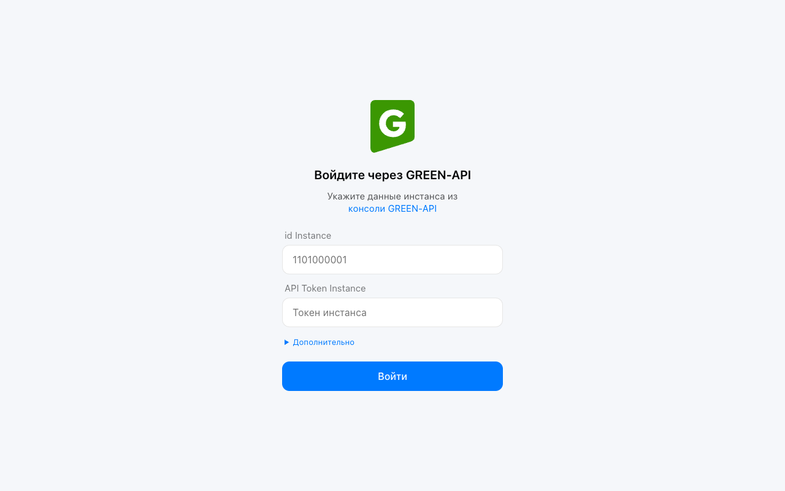
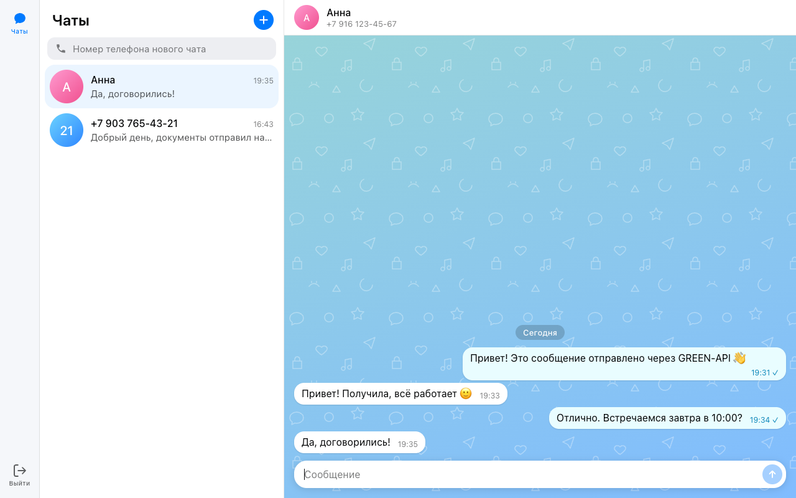
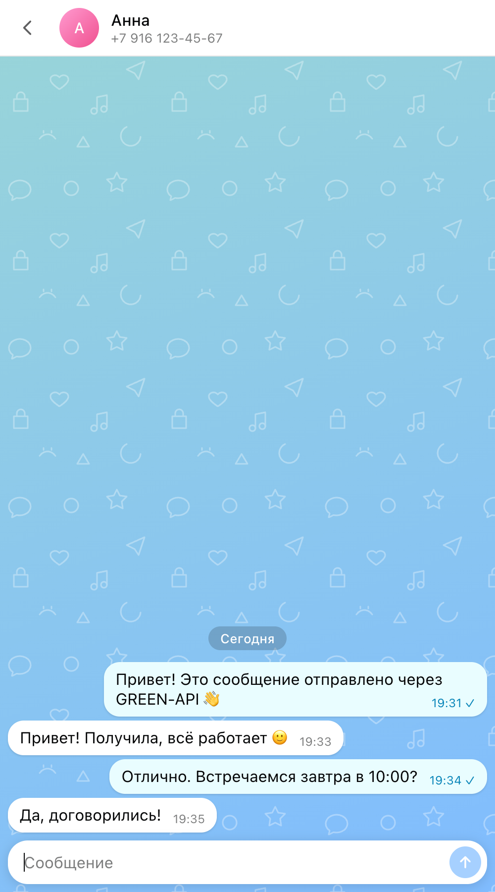

# GREEN-API Chat

Простой веб-чат для отправки и получения текстовых сообщений через сервис
[GREEN-API](https://green-api.com/). Интерфейс выполнен по прототипу веб-версии мессенджера
[MAX](https://web.max.ru/).

> **Выбор мессенджера.** Задание допускает реализацию для WhatsApp или Telegram, если нет
> возможности выполнить его для MAX. Методы GREEN-API одинаковы для всех мессенджеров, поэтому
> приложение не привязано к конкретному: достаточно указать `idInstance`, `apiTokenInstance` и `apiUrl` инстанса.
>
> - **WhatsApp** — полный сценарий задания проверен вживую: новый чат по номеру → отправка →
>   ответ получателя появился в чате.
> - **Telegram** — вживую проверены вход, список чатов, превью и история; отправка, получение
>   и склейка чата «номер → chatId Telegram» — на тестовых данных и юнит-тестами.
> - **MAX** — не проверялся: не было инстанса.

- **Демо:** https://Alexandr4e.github.io/green-api-chat/
- **Демо-режим без учётных данных** (фиктивная переписка для просмотра интерфейса):
  https://Alexandr4e.github.io/green-api-chat/?demo=1

| Вход | Чат | Мобильная версия |
|---|---|---|
|  |  |  |

## Возможности

1. Вход по учётным данным инстанса GREEN-API (`idInstance`, `apiTokenInstance`).
   Данные проверяются методом `getStateInstance` (инстанс должен быть в состоянии `authorized`).
2. Создание нового чата по номеру телефона получателя.
3. Отправка текстового сообщения — метод
   [SendMessage](https://green-api.com/v3/docs/api/sending/SendMessage/).
4. Получение входящих сообщений — технология
   [HTTP API](https://green-api.com/v3/docs/api/receiving/technology-http-api/):
   цикл `ReceiveNotification` (long polling, `receiveTimeout=5`) → обработка → `DeleteNotification`.
5. Отображение ответов собеседника в чате. Также показываются сообщения, отправленные вами
   с телефона (`outgoingMessageReceived`).
6. Список чатов аккаунта (`getChats`) после входа; каналы не показываются, так как писать в них нельзя.
7. Превью и сортировка чатов по последнему сообщению: журналы `lastIncomingMessages` и
   `lastOutgoingMessages` за 90 дней (максимум журналов), для остальных чатов — `getChatHistory` по одному запросу
   с паузой (как в разделе «Чаты» консоли GREEN-API).
8. История переписки (`getChatHistory`, последние 50 текстовых сообщений) при первом открытии чата.
9. Проверка настроек инстанса (`getSettings`): если уведомления о входящих или об отправленных
   через API выключены, приложение предлагает включить их (`setSettings`). Инстанс перезапускается,
   настройки применяются в течение 5 минут.
10. Проверка токена: при загрузке страницы и во время работы. Если токен изменён или удалён
    (`401`/`403`), приложение возвращает на форму входа с пояснением.

Запросы прерываются, если сервер не ответил за 20 секунд. При `429 Too Many Requests` и ошибках
сервера запросы повторяются до трёх раз; лимит `getChatHistory` и журналов — 1 запрос в секунду.

Обрабатываются только текстовые сообщения (`textMessage`, `extendedTextMessage`), остальные
уведомления подтверждаются и пропускаются.

## Локальный запуск

Требуется Node.js 22.18+ (тесты запускают TypeScript средствами Node; для сборки достаточно 20.19+).

```bash
git clone https://github.com/Alexandr4e/green-api-chat.git
cd green-api-chat
npm install
npm run dev
```

Откройте http://localhost:5173.

Тесты: `npm test` (встроенный раннер Node, без зависимостей).

Сборка production-версии: `npm run build` (результат в `dist/`), предпросмотр: `npm run preview`.

## Подготовка инстанса GREEN-API

1. Зарегистрируйтесь в [консоли GREEN-API](https://console.green-api.com), создайте инстанс
   (MAX, Telegram или WhatsApp) и авторизуйте его.
2. В настройках инстанса:
   - поле **URL для получения уведомлений (webhookUrl) оставьте пустым** — иначе уведомления
     уйдут на webhook и не попадут в очередь HTTP API;
   - включите получение входящих уведомлений о сообщениях (`incomingWebhook`), при желании —
     уведомления об исходящих (`outgoingWebhook`, `outgoingAPIMessageWebhook`).
3. Скопируйте `idInstance` и `apiTokenInstance`. Адрес API по умолчанию — `https://api.green-api.com`.
   У инстанса бывает свой хост (например, `https://7107.api.greenapi.com`) — он указан в консоли
   как apiUrl; введите его на форме входа в блоке «Дополнительно».

## Как пользоваться

1. Введите `idInstance`, `apiTokenInstance` и нажмите «Войти».
2. Выберите чат из списка или введите номер получателя в поле «Номер телефона нового чата»
   в международном формате (`+7 999 123-45-67`, `+90 531 …`) и нажмите Enter или «Создать».
3. Напишите сообщение и нажмите Enter (Shift+Enter — перенос строки).
4. Ответ получателя появится в чате в течение нескольких секунд.

> Чат, созданный по номеру (`79991234567@c.us`), после первого сообщения может
> получить числовой chatId (так ведёт себя, например, Telegram). Приложение сопоставляет его по `idMessage` отправленного
> сообщения и объединяет переписку в один чат.

## Ограничения

- Показываются только текстовые сообщения; у чатов, где есть только фото или стикеры, нет превью.
- GREEN-API хранит историю только с момента, когда у инстанса включены уведомления. Чтобы
  получить переписку WhatsApp до подключения, по документации нужно после сохранения настроек
  разлогинить инстанс и авторизоваться заново.
- На бесплатных тарифах GREEN-API действуют лимиты (например, Developer — 3 чата и 1000 сообщений в месяц).

## Структура

```
src/
  api/greenApi.ts            запросы к GREEN-API (sendMessage, receive/deleteNotification, getStateInstance)
  hooks/useNotifications.ts  цикл получения уведомлений по HTTP API
  store.ts                   reducer состояния чатов и сообщений
  components/
    LoginForm.tsx            форма входа
    NavRail.tsx              левая панель навигации
    Messenger.tsx            экран мессенджера: состояние, отправка, обработка уведомлений
    NotificationsNotice.tsx  предупреждение о выключенных уведомлениях инстанса
    Sidebar.tsx              список чатов и создание чата по номеру
    ChatWindow.tsx           окно переписки
    MessageBubble.tsx        сообщение
    MessageInput.tsx         поле ввода
    Avatar.tsx               аватар с инициалами
    icons.tsx                SVG-иконки
  utils/                     номера телефонов, разбор ответов API, повтор запросов, sessionStorage, время
  demo.ts                    данные для демо-режима (?demo=1)
tests/store.test.ts          тесты склейки чатов, разбора getChats и номеров телефонов
```

Стек: React 19, TypeScript, Vite. 
Внешних зависимостей, кроме React, нет.
Деплой на GitHub Pages — GitHub Actions (`.github/workflows/deploy.yml`).
Учётные данные и история чатов хранятся только в `sessionStorage` браузера: они сохраняются при
перезагрузке страницы и удаляются при закрытии вкладки или нажатии «Выйти».

